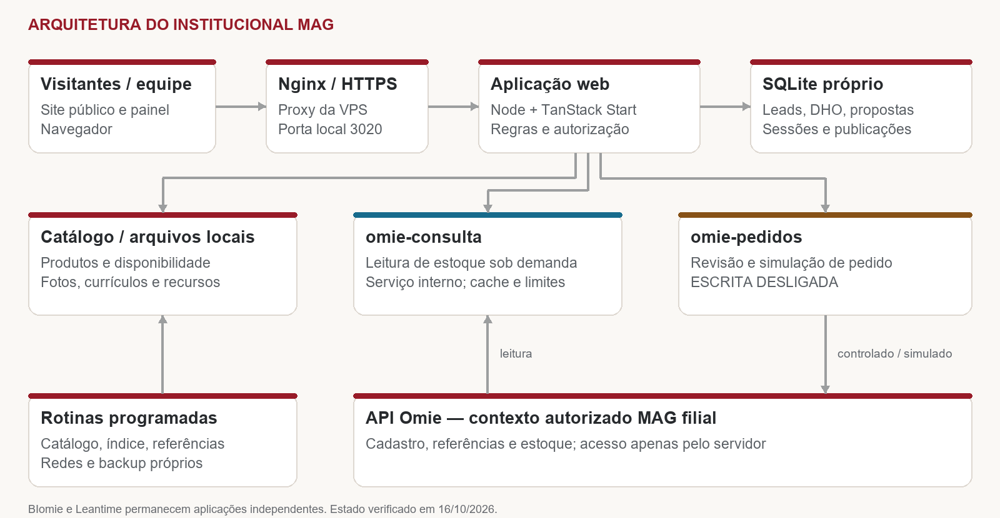

# MAG — Relatório do sistema atual

**Site, Comercial, Orçamentos, DHO e Árvore de links**  
Diagnóstico funcional e técnico para evolução com o Lovable  
**Posição verificada em 16 de outubro de 2026**

> Este documento descreve o sistema existente. As recomendações de evolução estão identificadas como propostas. A análise confrontou código local, arquivos da release ativa e estado agregado da VPS. Não alterou a aplicação, não criou pedidos, não enviou e-mails e não executou chamadas de negócio na API Omie. O material não contém senhas, tokens, chaves de API, currículos ou dados individuais de clientes/candidatos.

## 1. Visão executiva

O institucional MAG é uma aplicação própria que reúne o site público e um painel interno. Seu escopo atual cobre apresentação institucional, catálogo de produtos, captação de solicitações comerciais, elaboração de orçamentos e propostas, recrutamento e publicação da árvore de links.

O painel fica em **https://magmoveiscorporativos.com.br/interno** e utiliza três perfis: **Administrador, Comercial e DHO**. O login e o banco são próprios do institucional, separados do BIomie e do Leantime.

A aplicação tem interface em React/TypeScript e servidor em Node.js com TanStack Start. O banco transacional é SQLite na VPS. O Omie fornece cadastro de produtos, disponibilidade e referências comerciais por rotinas controladas; o navegador não recebe as credenciais do ERP.

Há dois objetos diferentes chamados de orçamento na operação: **solicitação de orçamento recebida do site** e **orçamento comercial interno**. A solicitação inicia o atendimento; o orçamento interno contém cliente, preços, condições e versões da proposta. Essa distinção precisa ficar explícita no novo visual.

Os pontos de maior impacto para a evolução são: unificar unidades e cadastros institucionais; conectar a fila de solicitações às negociações; tornar o fluxo da proposta mais claro; ampliar a gestão de conteúdo; organizar recrutamento por etapas; e criar o módulo de campanhas/banners com rastreio de cliques. O motor existente de permissões, cálculos, versões e integração deve ser preservado e ampliado de forma gradual.

## 2. Fotografia da produção

Marco principal da coleta: **16/10/2026 às 11h20, horário de Fortaleza/São Paulo**, com verificações complementares nesta mesma análise. Contagens são registros armazenados e podem incluir cadastros/testes; não devem ser interpretadas como vendas, contratações ou indicadores de resultado.

| Item verificado | Estado encontrado |
|---|---|
| Release ativa | `20261015-links-v2` |
| Serviços permanentes | `web`, `omie-consulta` e `omie-pedidos`, todos saudáveis |
| Banco | SQLite próprio em `/opt/mag-site/data/site.sqlite` |
| Usuários ativos | 3: um Administrador, um Comercial e um DHO |
| Produtos no catálogo público | 994 |
| Última atualização do catálogo | 16/10/2026, aproximadamente 04h03, horário local |
| Produtos no índice interno completo | 1.587; atualização aproximadamente 05h20 |
| Produtos com foto / sem foto | 418 / 576; 235 dos sem foto têm estoque segundo o relatório do sincronizador |
| Solicitações públicas de orçamento | 4: três novas e uma marcada como orçamento enviado |
| Contatos recebidos pelo formulário | 0 |
| Orçamentos internos | 4: um salvo, dois enviados e um cancelado |
| Versões de propostas | 8 |
| Clientes locais | 2 |
| Vínculos usuário → vendedor Omie | 2; cache com 33 registros de vendedores |
| Pedidos Omie registrados pelo módulo | 0 |
| Escrita de pedidos/clientes no Omie | **Desligada** no serviço em execução |
| Vagas / candidaturas | Uma vaga publicada e uma candidatura nova |
| Árvore de links | Publicação 8; duas unidades ativas e nenhum vendedor ativo |
| Fundo atual da árvore | Imagem personalizada; calendário de 12 meses armazenado como opção disponível |
| E-mails automáticos | Provedor/remetente ausentes; envio de avisos e envio direto de proposta indisponíveis |
| Retenção de recrutamento | Prazos não configurados; não há exclusão automática |
| Backup diário mais recente | Pacote de 16/10/2026 às 03h35; SQLite do pacote com integridade `ok` |

As páginas principais, catálogo, orçamento público, contato, carreiras, árvore, login, sitemap e QR responderam HTTP 200. A consulta interna de produtos sem autenticação respondeu HTTP 401. Oito arquivos centrais de regras, banco, autenticação e painel foram comparados por SHA-256 com a release ativa e coincidiram. A auditoria não corresponde a um novo teste completo de todos os fluxos em produção.

## 3. Organização dos módulos e acessos

| Área / endereço | Administrador | Comercial | DHO |
|---|---|---|---|
| Visão geral `/interno` | Sim | Indicadores comerciais | Indicadores de recrutamento |
| Consulta rápida `/interno/produtos` | Sim | Sim | Não |
| Solicitações `/interno/orcamentos` | Todas | Fila compartilhada | Não |
| Orçamentos internos `/interno/orcamentos-internos` | Todos | Somente os próprios | Não |
| Propostas e PDFs vinculados | Todos | Dos próprios orçamentos | Não |
| Contatos `/interno/contatos` | Sim | Sim | Não |
| Vagas `/interno/vagas` | Sim | Não | Sim |
| Candidaturas e banco `/interno/candidaturas` | Sim | Não | Sim |
| Currículos privados | Sim | Não | Sim |
| Redes `/interno/redes` | Sim | Não | Não |
| Árvore `/interno/links` | Sim | Não | Não |
| Configuração Omie `/interno/omie` | Sim | Não | Não |
| Emitente da proposta `/interno/proposta` | Sim | Não | Não |
| Usuários `/interno/usuarios` | Sim | Não | Não |
| Minha conta `/interno/conta` | Sim | Sim | Sim |

Uma conta pode ter mais de um perfil. As permissões se acumulam. O menu apenas reflete essas permissões: as funções no servidor e as rotas de download fazem a autorização efetiva.

A visão geral atual é simples: contadores de solicitações/contatos/candidaturas novos e listas recentes. Não foi encontrado painel gerencial completo de vendas, metas, conversão, produtividade, SLA ou recrutamento por período.

## 4. Arquitetura atual: interface e motor

| Camada | Componentes atuais | Responsabilidade |
|---|---|---|
| Interface | React 19, TypeScript, Tailwind, componentes Radix/shadcn, ícones Lucide | Site, formulários e painel responsivo |
| Navegação e dados | TanStack Router/Start e React Query | Rotas, carregamento, cache da interface e funções do servidor |
| Servidor | Node 24, TanStack Start, Nitro com destino `node-server` | Renderização, validação, permissões, banco, PDFs e arquivos |
| Regras | Módulos de orçamento/proposta e validações Zod | Estados, cálculos, contratos e bloqueios de operação |
| Banco | SQLite nativo do Node, WAL, chaves estrangeiras e transações | Usuários, atendimentos, recrutamento, propostas, vínculos e publicações |
| Integração | Serviços isolados e tarefas de manutenção | Catálogo, consulta Omie, referências, pedidos e redes |
| Infraestrutura | Docker Compose, Nginx e HTTPS na VPS | Execução, isolamento, limites de recursos, proxy e publicação |

Versões observadas no manifesto do projeto: React 19.2, TanStack Start 1.168.60, Router 1.170.41, Vite 8.1.5, TypeScript 5.8 e Zod 3.25. O lockfile fixa a resolução usada no build. PDFs utilizam `pdf-lib`; fotos são processadas com `sharp`; QR utiliza `qrcode`.

O motor não é apenas uma coleção de telas: há regras financeiras compartilhadas, validação no servidor, controle de concorrência por revisão, histórico de propostas, controle de acesso por dono e proteção contra duplicação de pedidos. Uma mudança visual precisa continuar chamando essas regras.

As operações do painel são, em grande parte, **server functions TanStack**, não uma API REST pública/documentada para outro frontend. Se uma nova interface usar outra arquitetura, será necessário definir uma camada de contratos e autenticação; não basta copiar telas e apontá-las ao banco.

## 5. Site público e catálogo

O endereço principal é **https://magmoveiscorporativos.com.br**. O site oferece home, produtos, categorias, ambientes, produto individual, apresentação da empresa, projetos, blog, contato, solicitação de orçamento, carreiras, redes e árvore de links. Projetos, posts e outros conteúdos sem dados oficiais podem ficar ocultos conforme a configuração de demonstração e as coleções disponíveis.

### Origem e atualização dos produtos

1. O sincronizador lê o cadastro autorizado da MAG filial no Omie em uma tarefa de servidor.
2. Aplica elegibilidade, classificação, regras de publicação, slugs e tratamento de imagens.
3. Grava `catalog.json`, mapa de URLs e fotos locais otimizadas.
4. O site consulta essa cópia local. Uma visita não dispara uma consulta ao Omie.

O catálogo público atual trabalha com **preço não publicado (`price: null`)** e três rótulos de disponibilidade: Pronta entrega, Disponível e Sob consulta. Quantidades exatas, reservas, custo, margem e locais internos de estoque não são enviados ao visitante. Se o estoque sincronizado ultrapassa o limite configurado de 30 horas, a apresentação fica conservadora, como sob consulta.

A busca opera sobre o catálogo publicado, com filtros/sugestões e tolerância a erros. O cliente pode montar uma lista de produtos para solicitar atendimento. Categorias e ambientes têm estrutura própria de apresentação, parte dela ainda definida em código.

### Gestão editorial atual

O painel Consulta rápida não é um editor de produto. Nome comercial, descrição, slug, SEO, características e prioridade podem ser enriquecidos pela camada editorial do sincronizador, mas essa camada usa arquivo no servidor. Na fotografia da VPS não havia `editorial.json` ou `overrides.json`, e o sincronizador indicava zero entradas editoriais.

Textos e composição da home, páginas institucionais, imagens principais, projetos, blog, depoimentos, logos e contatos globais ainda dependem de código/configuração. O sistema possui gestão de conteúdo em alguns módulos, mas ainda não oferece um CMS institucional completo.

As fotos precisam corresponder ao SKU correto. O levantamento de 576 produtos sem foto mostra uma melhoria de conteúdo com impacto visual concreto. O motor deve manter imagem neutra quando falta foto oficial, sem usar foto de outro produto.

## 6. Comercial: solicitações recebidas pelo site

Fluxo existente: **catálogo → lista de orçamento → formulário → protocolo → fila comercial → atendimento manual**.

O visitante escolhe produtos e quantidades; a lista é conservada no navegador. Ao enviar `/orcamento`, informa seus dados de contato e mensagem. O servidor valida campos, aplica limites de requisição e resolve nomes/SKUs pelo catálogo oficial. Não confia no nome de produto enviado pelo navegador. Itens repetidos da solicitação pública são consolidados.

O registro e seus itens são gravados no banco próprio e recebem protocolo. Depois, o sistema tenta notificar o Comercial por e-mail; uma falha de aviso não apaga a solicitação. O WhatsApp pode ser aberto com resumo para continuidade do atendimento.

No painel, Admin e Comercial conseguem pesquisar solicitações, ver produtos/quantidades, contatos, origem/UTMs, alterar status e escrever notas internas. Os estados são **novo, em atendimento, orçamento enviado, ganho e perdido**. Não há sequência rígida obrigatória entre esses estados.

As UTMs são capturadas da navegação e anexadas aos formulários. Novas UTMs podem substituir a captura anterior na sessão; isso não equivale a um histórico completo de atribuição nem a métricas de cliques da árvore.

O formulário de contato tem fila própria, com estados **novo, em atendimento e finalizado**. Hoje não existe unificação automática entre contato, solicitação de orçamento e negociação interna.

### Limites atuais

- As solicitações públicas ficam em fila compartilhada entre Admin e Comercial, sem responsável comercial próprio por lead.
- Não há distribuição automática por vendedor/unidade, próxima ação, lembrete, tarefa de retorno ou SLA.
- Criar orçamento interno a partir da solicitação copia os dados, mas os status dos dois registros não ficam sincronizados.
- O mesmo lead pode originar mais de um orçamento; o sistema não impõe unicidade para `source_request_id`.
- Enviar o formulário não efetua compra, pagamento, reserva de estoque ou inclusão automática de pedido no Omie.

## 7. Orçamento comercial interno

O orçamento interno é o registro da negociação. Pode ser criado vazio ou a partir de uma solicitação do site. Recebe proprietário e número sequencial no padrão **MAG-Q-AAAA-NNNNN**. O Comercial vê os próprios; o Admin vê todos. Quem transforma um lead em orçamento se torna dono desse orçamento.

### Informações mantidas

| Grupo | Dados / comportamento |
|---|---|
| Cliente | Nome/razão, fantasia, documento, contato, e-mail, telefone, cidade e UF |
| Produtos | Cadastro Omie, SKU, unidade, quantidade, preço digitado e desconto por item |
| Condições | Pagamento, previsão, consumidor final, e-mail de NF, conta da venda e observações operacionais |
| Proposta | A/C, validade, desconto geral, frete, montagem e observações comerciais |
| Controle | Proprietário, origem do lead, situação, revisão, datas e notas internas |

Os preços são preenchidos pelo Comercial; não há precificação automática por custo, margem ou tabela pública. Dinheiro é calculado em centavos inteiros no servidor. Quantidades podem ter até três casas decimais. O desconto em reais da linha incide sobre o total da linha, não por unidade.

**Total da proposta = soma dos itens após descontos individuais − desconto geral + frete + montagem.** O desconto geral não pode ultrapassar o subtotal. Os metadados dos produtos são resolvidos pelo servidor e os valores oficiais são recalculados nele.

A conta da venda é escolhida em cada orçamento. O sistema organiza as contas disponíveis e apresenta sugestões, mas a pessoa confirma a escolha; não existe uma conta aplicada automaticamente em todas as vendas. O limite atual é de 199 itens por orçamento.

### Estados e fluxo

Estados existentes: **rascunho, salvo, enviado, aceito, enviado_omie, erro_omie e cancelado**.

Fluxo principal: rascunho → salvo → enviado → aceito → revisão de integração → pedido no Omie. É possível aceitar a partir de salvo/enviado quando todas as pré-condições do fluxo e da proposta forem satisfeitas. Após o aceite, os dados aceitos ficam protegidos. Mudanças requerem nova revisão e novo aceite conforme as regras implementadas.

O aceite é registrado por uma pessoa da equipe no painel. Hoje não há portal público de aceite, assinatura eletrônica ou confirmação autônoma do cliente. O visual futuro precisa informar claramente quem registrou o aceite e qual versão foi aceita.

Salvar exige a revisão atual do registro, evitando sobrescrita silenciosa por outra aba. Duplicar orçamento cria nova negociação/número e não copia aceite, histórico de propostas ou pedido anterior. A previsão comercial aceita fica congelada: mudar antes do pedido exige nova revisão/proposta/aceite; depois da inclusão, ajustes operacionais de previsão pertencem ao ERP.

## 8. Proposta comercial e PDF

Gerar proposta cria uma versão v1, v2 etc., com um retrato dos dados utilizados: emitente, cliente, consultor, itens, totais, condições, validade e informações necessárias ao pedido. Há uma versão vigente por orçamento.

O PDF é gerado no servidor em A4, com identidade MAG, produtos, fotos disponíveis, valores e contatos autorizados do consultor. Não apresenta custo, margem, quantidade exata em estoque, locais internos ou notas privadas. O selo de pronta entrega exige catálogo atualizado e disponibilidade suficiente para a quantidade da proposta.

O consultor mostrado é o dono do orçamento, mesmo quando o Admin gera o documento. Em Minha conta, Admin/Comercial podem configurar nome, cargo, telefone, WhatsApp, e-mail, assinatura textual e contatos que desejam exibir. Quando não há perfil personalizado, há nome de fallback; telefone, WhatsApp e e-mail só aparecem se cadastrados e autorizados para exibição. Na fotografia da produção não havia perfil comercial personalizado gravado nessa tabela.

O Admin configura o emitente global e a validade padrão em `/interno/proposta`. Esses dados são específicos da proposta; não constituem cadastro global único de unidades para todos os módulos.

### Envio e histórico

- Visualizar/baixar PDF exige sessão e permissão. O documento não tem hoje um endereço público para o cliente.
- WhatsApp abre mensagem pronta. O PDF precisa ser anexado/compartilhado pela pessoa; não há envio automático de anexo por API oficial.
- Abrir WhatsApp, e-mail ou compartilhamento registra início da ação. Não prova envio, recebimento ou leitura.
- A pessoa marca explicitamente a versão como enviada ao cliente. Existe também marcação de recusa e aceite com regras próprias.
- Comparar versões mostra diferenças. Arquivar/desarquivar e exclusão lógica têm restrições; vigente, aceita e versões com histórico protegido não são apagadas livremente.
- Restaurar/editar negociação não deve reescrever os dados textuais dos snapshots anteriores.

O envio direto por e-mail com PDF existe no código, condicionado a `PROPOSTA_EMAIL_ENVIO=ligado`, provedor e remetente. **Está indisponível na produção verificada.** O caminho operacional atual é baixar o documento e utilizar o próprio programa de e-mail/compartilhamento.

### Limite documental importante

O snapshot preserva os dados, mas o PDF é renderizado novamente quando solicitado. Não há arquivamento binário imutável de cada PDF final. Fotos dependem de arquivos do catálogo, o logo é recurso da aplicação e a rota não impõe a verificação de divergência do checksum calculado pelo núcleo. Caso a MAG precise preservar exatamente o arquivo originalmente enviado, deve ser criada uma política de armazenamento do PDF e dos recursos por versão.

## 9. Integração Omie

Existem três caminhos separados:

| Caminho | Funcionamento hoje |
|---|---|
| Catálogo público | Leitura de arquivos sincronizados; sem chamada por visita |
| Consulta rápida interna | Busca local e consulta sob demanda de estoque pelo serviço `omie-consulta`, com cache e limites |
| Cliente/Pedido de Venda | Motor preparado no serviço `omie-pedidos`, com escrita atualmente desligada |

O cadastro completo interno inclui produtos que não aparecem no site. O estoque detalhado só é mostrado no painel autorizado. A sincronização de referências mantém vendedores, etapas, condições de pagamento, categorias e contas em cache próprio.

O Admin confirma o vínculo entre conta do painel e vendedor Omie. Sugestões por nome/e-mail não criam esse vínculo automaticamente. A autoria comercial no Omie é a do vendedor associado ao dono do orçamento; o executor da ação pode ser outra pessoa autorizada.

O motor permite pesquisar clientes no Omie e vincular explicitamente um cadastro existente. A criação de cliente novo é controlada pela escrita, exige dados confirmados, documento válido/e-mail e conferência de duplicidade. O e-mail fiscal do cadastro também pode ser conferido/selecionado pelo fluxo. Não há importação irrestrita de toda a carteira para o navegador.

Antes de criar pedido, o sistema confere cliente/documento, vendedor, pagamento, etapa, categoria, conta, estoque e integridade dos dados aceitos. A revisão gera token temporário de uso único ligado ao usuário, orçamento e conteúdo. Mudança dos dados exige outra revisão.

O fluxo tem travas e consulta pelo número de integração para prevenir inclusão duplicada. Se uma chamada de escrita tiver resultado incerto, o sistema deve consultar antes de repetir. Após inclusão confirmada, existe leitura de volta para conferir campos e totais.

As etapas de inclusão permitidas são 10, 20, 30 e 40. O motor não implementa faturamento, NF, cobrança, envio de Pix ou reserva de estoque; o payload usa `reservado=N`. O Admin pode definir a política de estoque insuficiente como confirmar, permitir ou bloquear. A consulta é uma fotografia e não reserva saldo, que pode mudar durante a negociação. A consulta de andamento do pedido é sob demanda.

### Situação operacional e bloqueios

**`OMIE_ORDER_WRITE_ENABLED=false` foi confirmado no serviço em execução.** Há zero registros em `omie_orders` na fotografia da produção. O recurso está em modo de preparação/simulação, não como uma integração de escrita homologada e utilizada nesta base.

Frete, montagem e desconto geral podem estar na proposta ao cliente, mas **bloqueiam a conversão para pedido hoje**. Frete e desconto geral têm suporte de código preparado e desligado em `EXTRAS_NO_PEDIDO`; montagem depende de definição fiscal/operacional ainda não implementada. Não se deve habilitar a escrita simplesmente mudando um botão no novo visual.

Também não existe unidade fiscal/comercial por orçamento. O cadastro físico Centro/BR-116 da árvore não segmenta automaticamente o emitente, os usuários, as negociações ou o contexto Omie. Uma evolução multiunidade precisa de modelagem e decisão de negócio explícitas.

## 10. DHO: recrutamento e banco de talentos

O DHO atual cobre **recrutamento**. Não foram identificados módulos de folha, ponto, férias, avaliação de desempenho, benefícios ou admissão formal.

### Vagas

Admin e DHO cadastram título, slug, área, local, modelo de trabalho, contratação, horário, resumo, descrição, responsabilidades, requisitos, diferenciais, prazo e prioridade. Estados: **rascunho, publicada e encerrada**.

Uma vaga publicada dentro do prazo aparece em Carreiras e recebe página própria. O servidor confirma a disponibilidade da vaga ao receber a candidatura. Depois da primeira publicação, o endereço é preservado; encerramento tira a vaga da listagem aberta sem depender de apagar o cadastro.

O prazo final é aplicado à visibilidade e ao recebimento do formulário. A data de abertura atual é informativa/ordenação: não agenda automaticamente uma publicação futura.

### Candidaturas

O candidato informa contato, localização, apresentação/LinkedIn opcionais e envia PDF de currículo. Há consentimento para a vaga e opção separada para banco de talentos; o cadastro espontâneo tem finalidade de banco. O candidato não precisa de conta.

O currículo é obrigatório, com limite de 5 MB. O servidor verifica formato e alguns marcadores de conteúdo ativo; essa verificação não equivale a uma análise antivírus completa. O arquivo é renomeado aleatoriamente e fica fora da pasta pública.

A candidatura recebe protocolo e estado novo. O detalhe interno mostra dados, vaga, finalidade, consentimento, mensagem, data de retenção quando configurada e download do arquivo. Comercial não acessa candidaturas ou currículos. Downloads são autorizados e auditados.

O painel tem abas de candidaturas a vagas e banco de talentos, filtros e notas internas. Uma mesma candidatura pode aparecer nas duas abas quando possui ambos os enquadramentos; isso não significa necessariamente duplicação física do registro.

Estados existentes: **novo, em análise, contato realizado, entrevista, banco de talentos e encerrado**. A mudança é manual. Ainda não há agenda de entrevista, avaliador, nota estruturada, decisão aprovado/reprovado, responsável ou próxima ação como entidades próprias.

### Retenção e finalidade

O motor calcula vencimento conforme os prazos de vaga e banco. Os dois prazos estavam ausentes no ambiente verificado. O script de retenção é de relatório e abre o banco em leitura: **não exclui registros nem currículos automaticamente**.

Mudar o status para Banco de talentos inclui a candidatura naquela visão operacional, mas não representa novo consentimento nem altera por si só a finalidade/prazo calculados. A evolução deve separar classificação de processo, autorização de uso dos dados e gestão do descarte.

Notificações ao DHO estão implementadas no código, mas não são enviadas na produção atual por ausência de provedor/remetente. O registro continua salvo no painel.

## 11. Árvore de links

Página pública: **https://magmoveiscorporativos.com.br/links/**. Administração: **/interno/links**, exclusiva do Administrador.

O editor reúne identidade, blocos de link/WhatsApp/vendedor/unidade/título, ordenação, visibilidade, fotos, prévia, rascunho, publicação e histórico. A página pública lê apenas a última publicação. Restaurar uma versão prepara um rascunho; publicar é uma ação posterior.

Os snapshots publicados têm proteção no banco contra atualização/exclusão. O controle de revisão evita que uma aba sobrescreva silenciosamente outra. O editor avisa sobre alterações não salvas e permite exportar o rascunho em caso de conflito.

As unidades possuem endereço, nome, cor, imagem, horário textual, Maps/Waze e contatos. O telefone fixo é separado de WhatsApp. Vendedores têm foto, função, mensagem e vínculo opcional com a unidade; sem vínculo ficam na equipe geral. O servidor impede vendedor ativo ligado a unidade inexistente ou oculta.

Na publicação conferida, BR-116 utiliza Travessa Sargento Portugal, 64, Aerolândia, Fortaleza/CE, CEP 60850-520; Centro utiliza Av. Dom Manuel, 1180, Centro, Fortaleza/CE, CEP 60060-091. Os horários estavam vazios. O campo de horário existe, mas não se deve inventar informação de funcionamento.

A página oferece filtro por unidade, rotas, ligação, WhatsApp, cópia de endereço e compartilhamento. A busca por nome/função aparece quando há pelo menos cinco vendedores ativos. O QR SVG sempre aponta ao endereço permanente da árvore.

Fundos podem ser fixos, calendário mensal ou imagem própria com sobreposição. O calendário possui 12 escolhas e utiliza o mês no horário de Fortaleza. **Na fotografia atual, a publicação está em modo imagem**, com duas unidades ativas e nenhum vendedor ativo; a existência do editor de vendedores não significa que a equipe já foi cadastrada.

Imagens de rascunho são privadas. A rota pública entrega apenas imagens utilizadas na publicação vigente; ao retirar a referência publicada, a URL deixa de responder publicamente. O servidor converte fotos para WebP e recusa animações na rotina atual.

### Recursos propostos, ainda ausentes

Carrossel/banner clicável, link próprio da capa, arte por formato de tela, catálogo de promoções, preços promocionais administráveis, início/fim de campanha, campanha por unidade, métricas de cliques e URLs/QR específicos por vendedor/unidade ainda não foram implementados. A movimentação decorativa do fundo não é um módulo de banner comercial.

### Cadastros de unidade ainda separados

Centro e BR-116 existem na árvore, mas os dados globais do contato/rodapé vêm de `src/config/site.ts`, que possui só um endereço. O emitente da proposta possui outra configuração própria. Essas três fontes precisam ser reconciliadas em um cadastro institucional global, com regras claras para dados comerciais/fiscais por unidade quando aplicáveis.

## 12. Redes sociais e conteúdo institucional

O painel Redes permite escolher modo Manual, API ou Desligada, perfil oficial e destaques cadastrados. Conteúdo de API é obtido por tarefa no servidor; o visitante não recebe tokens. Há verificação de identidade do perfil sincronizado antes de publicar conteúdo de API.

Na produção verificada não havia configurações de rede gravadas nem itens manuais. Assim, valem os quatro perfis padrão em modo Manual. Uma chave YouTube estava presente no servidor, mas essa presença isolada não ativa a exibição por API. As cópias sincronizadas estavam sem itens; não se deve apresentar as quatro redes como feeds automáticos conectados.

A home e `/redes` usam cards locais. A integração de vídeo do YouTube depende de clique e do consentimento correspondente; os links oficiais podem funcionar mesmo sem a API da rede.

O WordPress/CMS mencionado em arquivos de implantação é um modelo preparado, não evidência de um CMS institucional ativo conectado à aplicação atual. O motor real de operação é o painel próprio descrito neste relatório.

## 13. Autenticação, autorização e controles

As contas são criadas pelo Administrador. Senhas são derivadas com scrypt e salt; o banco guarda hash. A política implementada exige pelo menos 12 caracteres, maiúsculas, minúsculas e números.

Sessões possuem duração de oito horas e limite de dez por conta. O cookie utiliza HttpOnly, Secure em produção e SameSite=Lax. Os tokens ficam representados por hash no banco. Troca de senha, alteração de perfil, redefinição administrativa e desativação invalidam sessões conforme as operações implementadas.

O Admin pode criar contas, atribuir perfis, redefinir senha de outra conta e desativá-la. Não pode retirar o próprio acesso de Admin ou desativar a própria conta. Minha conta permite troca da própria senha e, nos perfis comerciais, configuração da apresentação na proposta.

Não foram encontrados 2FA/MFA, recuperação autônoma de senha ou obrigação técnica de troca no primeiro acesso. A descrição de senha provisória na interface não deve ser confundida com um bloqueio já implementado.

Há validação de entrada, proteção de origem para server functions, limites de requisição e campos antirrobô nos formulários. Turnstile está preparado, mas estava desligado/não configurado. A política CSP está em observação (Report-Only), não em modo de bloqueio.

Currículos e propostas têm rotas privadas. Fotos da árvore seguem publicação e autorização. Há auditoria técnica de operações; ainda não há uma tela completa de linha do tempo e auditoria com antes/depois por registro. Limites e controles existentes não substituem a necessidade de testes de autorização quando novas telas forem criadas.

## 14. Modelo de dados atual

| Grupo | Tabelas principais | Relações / uso |
|---|---|---|
| Identidade | `users`, `sessions`, `proposal_profiles` | Conta, papéis, sessões e perfil exibido nas propostas |
| Operação e proteção | `audit_log`, `rate_limits`, `counters` | Registro técnico, limites e numeração |
| Solicitações | `quote_requests`, `quote_request_items`, `contact_requests` | Lead público, itens e contatos |
| Comercial | `customers`, `internal_quotes`, `internal_quote_items` | Cliente local, proprietário, negociação e itens |
| Propostas | `quote_proposals`, `proposal_settings` | Snapshot/versões/estados e emitente global |
| Omie | `omie_sellers`, `seller_links`, `omie_refs`, `omie_settings`, `omie_orders` | Cache, vínculo de autoria, padrões e inclusão/estado de pedido |
| Recrutamento | `jobs`, `job_applications` | Vaga e candidatura; parte dos dados permanece em JSON |
| Redes | `social_settings`, `social_manual_items` | Preferências e destaques manuais |
| Árvore | `link_tree_draft`, `link_tree_publications`, `link_tree_images` | Rascunho, publicações imutáveis e registro de imagens |

Além do banco, o catálogo e os índices são arquivos JSON; fotos, currículos e recursos de redes ficam em diretórios persistentes próprios. Não se deve tratar cópia do banco como se contivesse automaticamente todos os arquivos da aplicação.

Relações centrais: usuário → orçamento interno → itens/propostas/pedido; lead público → orçamento interno por `source_request_id`; usuário → vendedor Omie por vínculo confirmado; vaga → candidatura; publicação da árvore → conteúdo e referências de imagens.

Unidades e vendedores públicos da árvore estão dentro do JSON do conteúdo, não em um cadastro relacional global de filiais/equipe comercial. Também não há hoje um `unit_id` comum nos leads, negociações e vagas que una todos os módulos.

## 15. Execução, rotinas e backup

O projeto usa diretório próprio `/opt/mag-site`, rede Compose própria, banco e volumes próprios. O Nginx encaminha HTTPS para o serviço web publicado apenas no loopback `127.0.0.1:3020`. A aplicação executa com usuário dedicado, raiz somente leitura e diretórios de dados separados. Os serviços internos Omie não têm portas públicas.

| Serviço / tarefa | Responsabilidade | Frequência observada |
|---|---|---|
| `web` | Site, painel, banco, arquivos e PDF | Permanente |
| `omie-consulta` | Consulta interna de estoque, cache e limites | Permanente; chamado sob demanda |
| `omie-pedidos` | Validação/simulação e futura escrita controlada | Permanente; escrita desligada |
| Sincronização de catálogo | Produtos elegíveis, estoque e fotos | 04h00 |
| Índice completo | Metadados para consulta interna | 05h20 |
| Referências Omie | Vendedores, etapas, pagamento, categoria e contas | 05h40 |
| Recuperação de atraso | Tenta catálogo se antigo conforme limiar | 06h40 |
| Redes sociais | Atualiza cópias/estado das integrações | Minuto 25 de cada hora |
| Backup | Banco consistente, arquivos e configuração | 03h35 |

Horários no fuso `America/Fortaleza`. A sincronização e a consulta têm limites próprios para evitar chamadas excessivas ao ERP. Segredos permanecem no servidor; o container web não recebeu `OMIE_APP_KEY`/`OMIE_APP_SECRET` na inspeção realizada.

A publicação usa releases identificadas, imagem Docker, verificação de saúde e retorno à imagem anterior se a troca não subir saudável. Uma reversão após mudança de formato dos dados pode exigir também recuperação compatível do banco; trocar apenas a imagem não é uma garantia universal de rollback.

O pacote local mais recente inspecionado foi `mag-site-20261016-033501.tar.gz`. O banco extraído em memória passou em integridade, e o pacote inclui currículos e imagens da árvore. A documentação operacional prevê retenção e cópia externa; esta revisão confirmou o pacote local, sem executar recuperação em outra VPS ou testar a cópia externa.

BIomie e Leantime permanecem aplicações separadas. A integração do institucional com o Omie não exige compartilhar o banco ou o login desses sistemas.

## 16. Principais lacunas e prioridades

Os itens abaixo são observações do código/estado atual e propostas de evolução; não representam incidentes comprovados.

| Prioridade | Ponto observado | Evolução recomendada |
|---|---|---|
| P0 — integridade | Estoque da revisão Omie compara por linha, embora o editor aceite SKU repetido | Consolidar quantidade por produto em todas as conferências e testar soma de linhas |
| P0 — coerência | Extras do PDF bloqueiam pedido e escrita está desligada | Manter bloqueios visíveis; decidir regras, homologar e só então ativar integração |
| P0 — base de trabalho | Documentos antigos citam Supabase/Cloud, estoque público numérico e módulos pendentes já existentes | Atualizar instruções e conhecimento do projeto a partir desta fotografia |
| P1 — organização | Solicitação e negociação separadas sem fluxo sincronizado | Relacionar, mostrar negociações vinculadas e controlar nova conversão |
| P1 — multiunidade | Árvore, contato e proposta possuem cadastros diferentes | Cadastro global de unidades; definir efeitos comerciais/fiscais antes de aplicar |
| P1 — operação | Notificações e envio direto de e-mail sem configuração | Configurar provedor e fila de envio/repetição com estado observável |
| P1 — conteúdo | Gestão institucional/editorial incompleta; muitos produtos sem foto | CMS e acervo por SKU com aprovação, prévia e publicação |
| P1 — comercial | Sem responsável por lead, tarefas/retorno e limites de desconto por papel | Funil, próxima ação e política de aprovação definidos pela MAG |
| P1 — DHO | Sem agenda, responsável e avaliação estruturada; retenção sem política ativa | Funil de recrutamento, eventos/avaliações e gestão de finalidade/descarte |
| P1 — árvore/campanhas | Banner promocional, agendamento e métricas ainda ausentes | Módulo de campanhas com arte, destino, vigência, unidade e cliques agregados |
| P2 — documentos | PDF não armazenado como artefato final por versão | Arquivo final imutável com hash e recursos preservados, se exigido pela operação |
| P2 — escala | Listagens limitadas sem paginação; tokens de revisão em memória; migrações na inicialização | Paginação/filtros, migrações versionadas e estado temporário persistente quando necessário |
| P2 — gestão | Dashboard básico e auditoria sem tela gerencial completa | Indicadores com definição de cálculo e linha do tempo por entidade |

Também merecem desenho específico: troca obrigatória de senha temporária, MFA e recuperação de acesso. Políticas de consentimento/retenção e texto institucional dependem de definição/aprovação da MAG; desenhar a tela não resolve essas decisões.

## 17. Estrutura visual recomendada para a próxima versão

Uma navegação lateral por áreas ajudaria a dar contexto ao operador e reduziria a mistura de termos no menu atual:

1. **Visão geral:** agenda de ações, indicadores por perfil e alertas reais.
2. **Comercial:** Solicitações do site, Contatos, Negociações/Orçamentos, Propostas e consulta de produtos.
3. **DHO:** Vagas, Candidaturas, Banco de talentos e, como evolução, Entrevistas.
4. **Site e Marketing:** Conteúdo institucional, Produtos editoriais, Redes, Árvore e Campanhas. CMS/campanhas são novos módulos.
5. **Administração:** Unidades, Usuários e acessos, Emitente, Omie, Notificações e Auditoria. Parte dessa administração ainda precisa ser criada.
6. **Minha conta:** acesso, perfil comercial e preferências autorizadas.

Na negociação, utilizar um fluxo visível Cliente → Itens → Condições → Proposta → Envio → Aceite → Omie. Mostrar proprietário, versão vigente, totais e bloqueios no contexto da ação. Distinguir salvar rascunho, gerar proposta, marcar envio, registrar aceite e criar pedido; hoje essas ações já têm significados diferentes no motor.

No DHO, permitir visão em tabela e funil sobre as mesmas entidades; datas de entrevista, responsável e avaliação exigem campos novos. Na árvore, manter prévia e publicação e acrescentar campanhas como entidade própria, em vez de usar links comuns para simular todo o fluxo.

## 18. Evolução recomendada do motor

A aplicação pode continuar modular no mesmo projeto. Uma primeira melhoria útil é consolidar serviços de domínio para Comercial, Recrutamento, Publicação e Integrações, com contratos de entrada/saída explícitos e autorização central consistente. Isso aproveita a infraestrutura existente.

Novas entidades propostas: unidades globais, diretório público aprovado de vendedores, responsáveis/atividades de lead, entrevistas/avaliações, campanhas/banners, eventos agregados de cliques, fila de notificações e trilha de auditoria consultável. Esses nomes representam desenho futuro, não tabelas já existentes.

Separar usuário de acesso, perfil do consultor na proposta, vendedor Omie e contato público da árvore. Eles podem ser relacionados, mas têm permissões e finalidades diferentes. Uma mudança em Minha conta não deve publicar automaticamente um telefone/foto no site.

Manter SQLite é viável na etapa atual de uma única aplicação, desde que operações e migrações sejam bem definidas. PostgreSQL próprio pode ser avaliado para maior concorrência, múltiplas instâncias ou necessidades de relatório; isso requer migração de dados, arquivos, autenticação e testes. Não há necessidade de mudar o banco apenas para renovar a interface.

Campos financeiros oficiais continuam no servidor, em centavos. Omie permanece acessível por componentes controlados. Propostas e campanhas devem manter versões e autorização. A inclusão no ERP exige homologação específica; não é consequência automática do redesenho visual.

## 19. Como usar este material no Lovable

A documentação oficial permite manter instruções persistentes em Project Knowledge; o arquivo resumido entregue com este relatório foi preparado para essa finalidade. Use o relatório completo como referência e o briefing como solicitação de trabalho por etapas. [Fonte: conhecimento do projeto no Lovable](https://docs.lovable.dev/features/knowledge).

Há referências de template Lovable no projeto local, mas elas não comprovam uma sincronização ativa com a release da VPS. O diretório local não possui um checkout Git identificado nesta revisão. Primeiro é necessário identificar o projeto original e seu repositório/branch e reconciliar a versão que ele enxerga com o código em produção.

O Git sync do Lovable acompanha uma branch por vez. A documentação informa que não há importação genérica de um repositório GitHub existente pela mesma integração. Por isso, não tratar um ZIP do servidor como uma importação automática do sistema no editor. [Fonte: integração GitHub](https://docs.lovable.dev/integrations/github).

O uso recomendado aqui é Lovable para planejamento e evolução da interface, com contratos do motor preservados e validação da execução Node na VPS. TanStack Start executa servidor e não deve ser publicado como um pacote apenas estático. O backend customizado SQLite/Node atual exige validação específica no ambiente de prévia; não é o backend Cloud padrão. [Fonte: hospedagem e execução](https://docs.lovable.dev/tips-tricks/deployment-hosting-ownership).

### Ordem de trabalho proposta

1. Consolidar o código de referência e atualizar instruções contraditórias, sem substituir banco ou publicar na VPS nesta etapa.
2. Pedir arquitetura de informação, design system, mapa de telas e protótipo navegável com dados fictícios identificados.
3. Aprovar contratos e estados reais; conectar módulo por módulo aos serviços existentes.
4. Corrigir integridade e lacunas prioritárias do motor com testes.
5. Validar em ambiente separado: permissões, registros existentes, cálculos, versões, currículos e imagens.
6. Publicar uma release revisada com backup e retorno compatível, preservando os demais sistemas.

### Critérios para avaliar a nova entrega

- Diferencia solicitações, negociações e versões de proposta e preserva seus vínculos.
- Não transforma abertura de WhatsApp em prova de envio ou aceite do cliente.
- Respeita Admin/Comercial/DHO no servidor, inclusive PDFs e currículos.
- Comercial continua limitado aos próprios orçamentos internos; atribuição de leads nova é explícita.
- Recalcula valores no servidor e preserva versões/aceites anteriores.
- Não cria pedidos, ativa escrita Omie ou publica preços/estoque numérico sem a regra aprovada.
- Reutiliza catálogo e fotos do SKU correto, com estado de sincronização visível.
- Árvore/campanhas mantêm rascunho, prévia, publicação e privacidade de arquivos.
- DHO distingue etapa operacional de consentimento/finalidade.
- Preserva dados e infraestrutura e demonstra testes dos fluxos alterados.

## 20. Fontes e rastreabilidade

Fontes principais do código:

| Área | Referências |
|---|---|
| Rotas e painel | `src/routes/`, `src/components/interno/ui.tsx`, `src/router.tsx` |
| Banco e acesso | `src/lib/local-db.server.ts`, `local-auth-core.server.ts`, `local-auth.server.ts`, `auth.functions.ts`, `admin.functions.ts` |
| Formulários | `src/lib/leads.functions.ts`, `quote.tsx`, `utm.ts`, `security.server.ts` |
| Orçamento | `src/lib/orcamentos.server.ts`, `orcamentos.functions.ts`, `orcamento-regras.ts` |
| Proposta | `src/lib/propostas.server.ts`, `propostas.functions.ts`, `proposta-regras.ts`, `proposta-pdf.server.ts`, `proposta-conteudo.server.ts` |
| Omie | `src/lib/omie*.ts`, `produtos-internos.server.ts`, scripts `sync-omie`, `omie-indice`, `omie-referencias`, `omie-consulta`, `omie-pedidos` |
| DHO | `src/lib/hr.functions.ts`, `careers.server.ts`, `careers.functions.ts`, `retention.ts`, `scripts/recruitment-retention.mjs` |
| Árvore | `src/lib/links*.ts`, `LinkTreeEditor.tsx`, `LinkTreeEditorImage.tsx`, `LinkTreeView.tsx`, rotas de QR/imagens |
| Redes e configuração | `src/lib/social*.ts`, `src/config/site.ts`, `src/config/social.ts`, `src/config/notifications.server.ts` |
| Infraestrutura | `Dockerfile`, `deploy/compose.yaml`, scripts de implantação/backup; conferência com arquivos vivos na VPS |

Evidências de produção: tag/saúde dos containers, agregados SQL em leitura, booleans de configuração do ambiente em execução, catálogo/status/índice, agendas do host, pacote de backup e respostas HTTP. Não foram extraídas linhas pessoais ou credenciais para o relatório.

Documentos locais como `ARQUITETURA.md`, `roadmap.md` e partes de `DEPLOY-VPS.md` contêm trechos legados. Quando há divergência, este diagnóstico se baseia na implementação e no estado verificado da release ativa. Não interpretar dependência `supabase` ou pasta `supabase/` como prova de que esse serviço gerencia os dados atuais.

Notas detalhadas de leitura e exemplos dos contratos estão entregues como anexos técnicos. As funcionalidades novas discutidas neste documento permanecem propostas: o relatório não executou uma nova implementação ou publicação.
